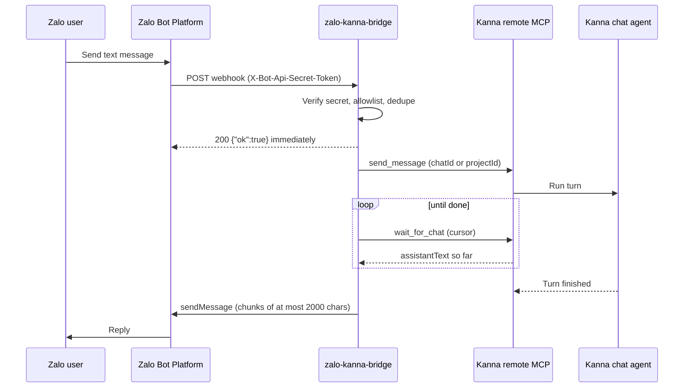

# zalo-kanna-bridge

A small Bun + TypeScript service that lets you talk to a [Kanna](https://github.com/cuongtranba/kanna) coding agent from Zalo. It receives Zalo Bot Platform webhooks, forwards each text message to Kanna's remote MCP server, waits for the agent to finish, and sends the reply back to the same Zalo chat.



## Requirements

- Kanna started with a password and **Remote MCP enabled**, reachable from the bridge (for example `https://kanna.example.com/mcp`).
- A Zalo bot token from **Zalo Bot Creator**.
- A public HTTPS URL for the webhook (Zalo refuses plain HTTP).
- [Bun](https://bun.sh) 1.x, or Docker.

## Configuration

All configuration is through environment variables, validated at startup. The bridge refuses to start and lists what is missing or invalid.

| Variable | Required | Default | Description |
| --- | --- | --- | --- |
| `ZALO_BOT_TOKEN` | yes | | Zalo bot token. |
| `ZALO_WEBHOOK_SECRET` | yes | | Secret (8–256 chars) Zalo sends in `X-Bot-Api-Secret-Token`. |
| `KANNA_MCP_URL` | yes | | Kanna remote MCP endpoint, e.g. `https://kanna.example.com/mcp`. |
| `KANNA_PASSWORD` | yes | | Kanna password, sent as `Authorization: Bearer`. |
| `KANNA_PROJECT_ID` | yes | | Kanna project that new chats open in. |
| `ZALO_ALLOWED_USER_IDS` | yes | | Comma-separated Zalo user ids allowed to use the bot. Must not be empty. |
| `PORT` | no | `3000` | HTTP port. |
| `WEBHOOK_PATH` | no | `/zalo/webhook` | Path Zalo posts to. |
| `STATE_FILE` | no | `./data/state.json` | Where the Zalo chat to Kanna chat mapping is stored. |
| `KANNA_TURN_DEADLINE_SECONDS` | no | `1800` | How long to follow one turn before telling the user to check Kanna. |

Copy `.env.example` to `.env` for local use. Never commit it.

## Run locally

```bash
bun install
cp .env.example .env   # fill in real values
bun run start
```

Bun loads `.env` from the working directory automatically. Expose the port with a tunnel so Zalo can reach it:

```bash
cloudflared tunnel --url http://localhost:3000
# or
ngrok http 3000
```

Then register the public URL as the webhook (see below).

## Deploy with Docker / Dokploy

```bash
docker build -t zalo-kanna-bridge .
docker run -d --name zalo-kanna-bridge \
  --env-file .env \
  -p 3000:3000 \
  -v zalo-kanna-bridge-data:/app/data \
  zalo-kanna-bridge
```

The image runs as the non-root `bun` user, stores state in `/app/data/state.json`, and exposes a `/healthz` health check. **Mount a volume on `/app/data`** (in Dokploy, add a volume mount to `/app/data`) or the conversation mapping is lost on every redeploy. Set the environment variables in the Dokploy environment tab and point the domain at port 3000.

## Register the webhook

After the bridge is reachable over public HTTPS:

```bash
ZALO_BOT_TOKEN=... ZALO_WEBHOOK_SECRET=... \
  bun run set-webhook https://your-public-host/zalo/webhook
```

The script calls `setWebhook` and prints Zalo's `verification` result. It never prints the token. The secret must be the same value as `ZALO_WEBHOOK_SECRET` on the running service.

## Find your Zalo user id

The allowlist is mandatory, so you need your own id before the bot answers you:

1. Start the bridge with any placeholder in `ZALO_ALLOWED_USER_IDS` (for example `0`).
2. Send the bot a message from your Zalo account.
3. Read the log line `ignored message from unlisted user id <id> (<display name>)`.
4. Put that id in `ZALO_ALLOWED_USER_IDS` and restart.

## Commands

- `/new` starts a fresh Kanna conversation for this Zalo chat. The next message opens a new Kanna chat in `KANNA_PROJECT_ID`.

Each Zalo chat is mapped to one Kanna chat, so follow-up messages continue the same conversation.

## Security notes

- **The allowlist is mandatory.** Messages drive a coding agent that has tool access on the machine Kanna runs on. An empty allowlist makes the bridge refuse to start, and messages from other users are ignored.
- Requests are accepted only with the correct `X-Bot-Api-Secret-Token`, compared in constant time. Anything else gets `403` before the body is read.
- **Permission prompts are never approved from Zalo.** When the agent needs approval the bridge tells you to open Kanna and stops following the turn.
- Secrets (bot token, webhook secret, Kanna password) come only from the environment and are never logged.
- Put the bridge behind HTTPS and keep the webhook path unguessable if you can.

## Limitations

- Text messages only. Images, stickers and voice get a "not supported" reply.
- Replies longer than 2000 characters are split into several messages (Zalo's limit), preferring newline or space boundaries.
- Updates arrive by webhook only; `getUpdates` polling is not used.
- Replies are plain text; Zalo markdown or HTML rendering is not used.
- Conversation mapping lives in a single JSON file, so run one instance.

## Development

```bash
bun run typecheck
bun test
```

## License

MIT
