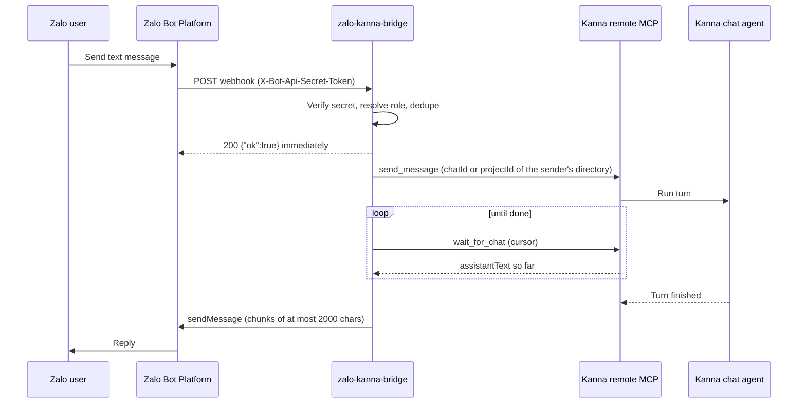

# zalo-kanna-bridge

A small Bun + TypeScript service that lets you talk to a [Kanna](https://github.com/cuongtranba/kanna) coding agent from Zalo. It receives Zalo Bot Platform webhooks, forwards each text message to Kanna's remote MCP server, waits for the agent to finish, and sends the reply back to the same Zalo chat.



## Requirements

- Kanna started with a password and **Remote MCP enabled**, reachable from the bridge (for example `https://kanna.example.com/mcp`).
- A Zalo bot token from **Zalo Bot Creator**.
- A public HTTPS URL for the webhook (Zalo refuses plain HTTP).
- [Bun](https://bun.sh) 1.x, or Docker.

## Configuration

All configuration is through environment variables, validated at startup. The bridge refuses to start and lists what is missing or invalid. If only `ZALO_ALLOWED_USER_IDS` or `KANNA_PROJECT_ID` is still set, the error names the variable that replaces it.

| Variable | Required | Default | Description |
| --- | --- | --- | --- |
| `ZALO_BOT_TOKEN` | yes | | Zalo bot token. |
| `ZALO_WEBHOOK_SECRET` | yes | | Secret (8–256 chars) Zalo sends in `X-Bot-Api-Secret-Token`. |
| `KANNA_MCP_URL` | yes | | Kanna remote MCP endpoint, e.g. `https://kanna.example.com/mcp`. |
| `KANNA_PASSWORD` | yes | | Kanna password, sent as `Authorization: Bearer`. |
| `ZALO_SUPERADMIN_IDS` | yes | | Comma-separated Zalo user ids with full control. Must not be empty. Replaces `ZALO_ALLOWED_USER_IDS`. |
| `KANNA_DEFAULT_DIR` | yes | | Directory superadmins start in, absolute (`/...`) or `~/...`. Kanna opens it as a project (and creates it if missing). Replaces `KANNA_PROJECT_ID`. |
| `ZALO_USER_DIR_ROOT` | no | | When set, `/assign` and the admin `assign` action only accept directories at or below this path. Superadmins' own `/dir` is not restricted. |
| `PORT` | no | `3000` | HTTP port. |
| `WEBHOOK_PATH` | no | `/zalo/webhook` | Path Zalo posts to. |
| `STATE_FILE` | no | `./data/state.json` | Where conversations, users and assignments are stored. |
| `KANNA_TURN_DEADLINE_SECONDS` | no | `1800` | How long to follow one turn before telling the user to check Kanna. |
| `BRIDGE_LANGUAGE` | no | `en` | Language of every message the bridge itself sends: `en` or `vi`. Anything else is a startup error. The text sent to the Kanna agent stays English. |
| `PROGRESS_ACK` | no | `true` | Send an acknowledgement ("Got it, working on it…") as soon as a message is accepted for Kanna. `true` or `false`. |
| `PROGRESS_POLL_SECONDS` | no | `15` | How long each call to Kanna waits (5–90) before the bridge looks at progress again. |
| `PROGRESS_UPDATE_SECONDS` | no | `60` | Send a "Still working…" status when nothing has been sent to the user for this long (15–600). |
| `PROGRESS_TYPING_SECONDS` | no | `5` | How often the typing indicator is refreshed while Kanna works (2–30). |

Copy `.env.example` to `.env` for local use. Never commit it.

## Run locally

```bash
bun install
cp .env.example .env   # fill in real values
bun run start
```

Bun loads `.env` from the working directory automatically. Expose the port with a tunnel so Zalo can reach it:

```bash
cloudflared tunnel --url http://localhost:3000
# or
ngrok http 3000
```

Then register the public URL as the webhook (see below).

## Deploy with Docker / Dokploy

```bash
docker build -t zalo-kanna-bridge .
docker run -d --name zalo-kanna-bridge \
  --env-file .env \
  -p 3000:3000 \
  -v zalo-kanna-bridge-data:/app/data \
  zalo-kanna-bridge
```

The image runs as the non-root `bun` user, stores state in `/app/data/state.json`, and exposes a `/healthz` health check. **Mount a volume on `/app/data`** (in Dokploy, add a volume mount to `/app/data`) or the conversation mapping is lost on every redeploy. Set the environment variables in the Dokploy environment tab and point the domain at port 3000.

## Register the webhook

After the bridge is reachable over public HTTPS:

```bash
ZALO_BOT_TOKEN=... ZALO_WEBHOOK_SECRET=... \
  bun run set-webhook https://your-public-host/zalo/webhook
```

The script calls `setWebhook` and prints Zalo's `verification` result. It never prints the token. The secret must be the same value as `ZALO_WEBHOOK_SECRET` on the running service.

## Progress feedback

A Kanna turn can take minutes, so for every message that goes to Kanna (not slash commands, not unknown senders) the bridge shows that it is alive:

1. It sends Zalo's `typing` chat action and then the acknowledgement, and refreshes the typing indicator every `PROGRESS_TYPING_SECONDS` until the turn ends.
2. It follows the turn in slices of `PROGRESS_POLL_SECONDS`. Text Kanna has written so far is sent to Zalo as soon as it arrives, so a long answer shows up in pieces. If a slice brings no text and nothing has been sent for `PROGRESS_UPDATE_SECONDS`, it sends a status such as `Still working… (Bash, Read)`, naming up to five tools Kanna used (the `mcp__<server>__` prefix is dropped).
3. The last text, the waiting-for-approval notice or the failure/deadline message comes last. A turn that sent no answer text at all still gets the "finished without a text reply" message.

`/approve`, `/deny` and `/answer` resume a waiting turn with the same typing, streaming and status behaviour, but no acknowledgement. A failed typing action or acknowledgement is logged and never stops the turn.

`ZALO_BRIDGE_ACTION` lines are removed from every piece before it is sent. They are run, for superadmin turns only, after the turn ends, and their confirmations are appended to the last message.

## Roles

The bot decides who is talking from the sender's Zalo id.

| Sender | Messages go to | Commands |
| --- | --- | --- |
| Superadmin (`ZALO_SUPERADMIN_IDS`) | Their current directory (starts at `KANNA_DEFAULT_DIR`) | All of them |
| Assigned user | Only the directory a superadmin assigned | `/help`, `/whoami`, `/new` |
| Anyone else | Nothing | Gets "You don't have access to this bot yet. Your Zalo id is `<id>`" at most once per 24 hours |

Every Zalo sender has their own Kanna conversation, even inside a group chat. Replies go back to the chat the message came from.

In groups the bot only receives messages that mention it, so mention the bot first: commands work as `@<bot> /whoami`. At startup the bridge reads the bot's own name with Zalo's `getMe` and removes `@<bot name>` from every message before handling it, so neither commands nor Kanna see the mention. If `getMe` fails, the bridge logs a warning and carries on without stripping. A message that is only the mention is treated as `/help`.

## Find your Zalo user id

1. Start the bridge with any placeholder in `ZALO_SUPERADMIN_IDS` (for example `0`).
2. Send the bot a message from your Zalo account. It replies with "Your Zalo id is `<id>`", and the log shows `ignored message from unlisted user id <id> (<display name>)`.
3. Put that id in `ZALO_SUPERADMIN_IDS` and restart.

To give someone else access, ask them to message the bot once, then use `/users` to see their id and `/assign` to give them a directory.

## Commands

Commands are matched on the first word, case-insensitively, and handled by the bridge; they are never sent to Kanna. Any other text goes to the Kanna agent.

| Command | Who | What it does |
| --- | --- | --- |
| `/help` | everyone | Lists the commands available to you. |
| `/whoami` | everyone | Shows your role, Zalo id and directory. |
| `/new` | everyone | Starts a fresh Kanna conversation. |
| `/dir [path]` | superadmin | Shows or changes your own directory. Kanna creates it if missing. |
| `/assign <zaloId> <path>` | superadmin | Gives a user access to one directory. Fails if Kanna cannot open it or it is outside `ZALO_USER_DIR_ROOT`. |
| `/unassign <zaloId>` | superadmin | Removes a user. |
| `/users` | superadmin | Lists assigned users and people who messaged the bot but are not assigned. |
| `/approve [zaloId]` | superadmin | Approves the waiting tool request (a plan, for `ExitPlanMode`). |
| `/deny [zaloId] [reason]` | superadmin | Denies it; for a plan the reason is sent back as feedback. |
| `/answer [zaloId] <text>` | superadmin | Answers the first question of a waiting `AskUserQuestion`. |
| `/mcp <tool> [json]` | superadmin | Calls any Kanna remote MCP tool and returns its text, e.g. `/mcp list_chats {"projectId":"..."}`. |

Paths must be absolute (`/srv/data`) or start with `~/`. Relative paths are refused.

A superadmin who runs `/approve`, `/deny` or `/answer` without an id acts on their own waiting conversation. When a user's turn is waiting, every superadmin who has messaged the bot in a private chat is notified with the request and `/approve <zaloId>`, `/deny <zaloId> <reason>`, `/answer <zaloId> <text>`. The id form works while the bridge keeps running; the pending request itself stays in Kanna.

## Ask the bot in plain language

Superadmin messages carry a short bridge preamble telling the agent it may manage users. The agent asks for an action by writing one line in its reply:

```
ZALO_BRIDGE_ACTION {"action":"assign","userId":"<zaloId>","dir":"<absolute path>"}
```

Supported actions are `assign {userId, dir}`, `unassign {userId}` and `set_dir {dir}`. The bridge removes these lines from every part of the reply, runs them once the turn has ended and only when it belongs to a superadmin, and appends a confirmation or error for each to the last message. The same lines in a user's turn are removed, ignored and logged. This uses no extra Kanna tool.

## Security notes

- **Access is closed by default.** Unknown senders get one polite refusal per day and nothing reaches Kanna. An empty `ZALO_SUPERADMIN_IDS` makes the bridge refuse to start.
- Requests are accepted only with the correct `X-Bot-Api-Secret-Token`, compared in constant time. Anything else gets `403` before the body is read.
- Permission prompts are answered only by superadmins, with `/approve`, `/deny` or `/answer`.
- Secrets (bot token, webhook secret, Kanna password) come only from the environment and are never logged.
- Put the bridge behind HTTPS and keep the webhook path unguessable if you can.

## Limitations

**Confinement is a bridge rule, not a sandbox.** The bridge guarantees that an assigned user's conversation always starts in their directory, that they cannot change it, and that they cannot run admin commands. It also tells the agent to stay inside that directory. It cannot stop the agent from reading or changing other files: Kanna runs the agent with the permissions of the Kanna server, and the bridge uses the Kanna admin password. A user who asks the agent to look elsewhere, or whose agent can use other MCP servers configured in Kanna, may succeed. Only assign people you would trust with the access of the machine Kanna runs on, or run Kanna itself in a container or VM if you need real isolation.

- The same trust applies to superadmin turns: text the agent reads (a file, a web page) could make it print a `ZALO_BRIDGE_ACTION` line. Keep `ZALO_USER_DIR_ROOT` set so assignments stay in one tree.
- Text messages only. Images, stickers and voice get a "not supported" reply.
- Replies longer than 2000 characters are split into several messages (Zalo's limit), preferring newline or space boundaries. `/mcp` output is cut at about 6000 characters.
- Updates arrive by webhook only; `getUpdates` polling is not used.
- A `ZALO_BRIDGE_ACTION` line is only recognised when it arrives whole inside one piece of Kanna text; a line split across two pieces would not be stripped.
- Replies are plain text; Zalo markdown or HTML rendering is not used.
- State (conversations, users, assignments, who messaged the bot) lives in a single JSON file, so run one instance. An old version 1 state file is migrated on start; its conversations are dropped, so each person starts a fresh Kanna chat.
- `/approve <zaloId>` needs the bridge to have seen that user's waiting turn since it started. After a restart, answer in Kanna.
- Admin notifications about a waiting user go to each superadmin's most recent private chat with the bot, so a superadmin who has only used groups is not notified.

## Development

```bash
bun run typecheck
bun test
```

## License

MIT
